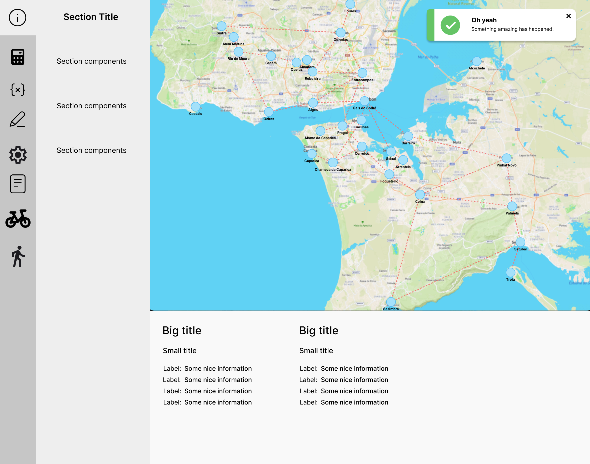
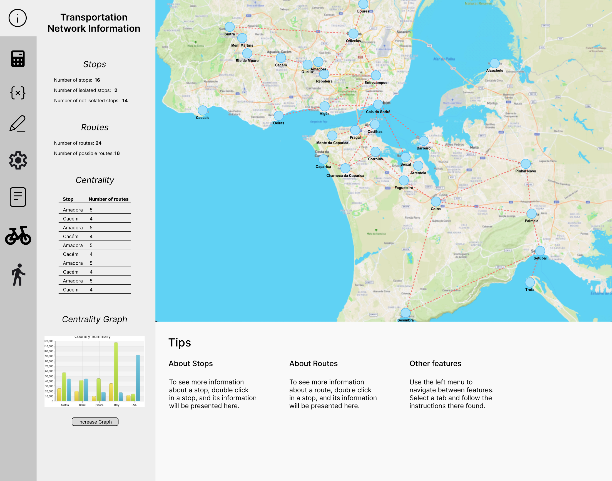
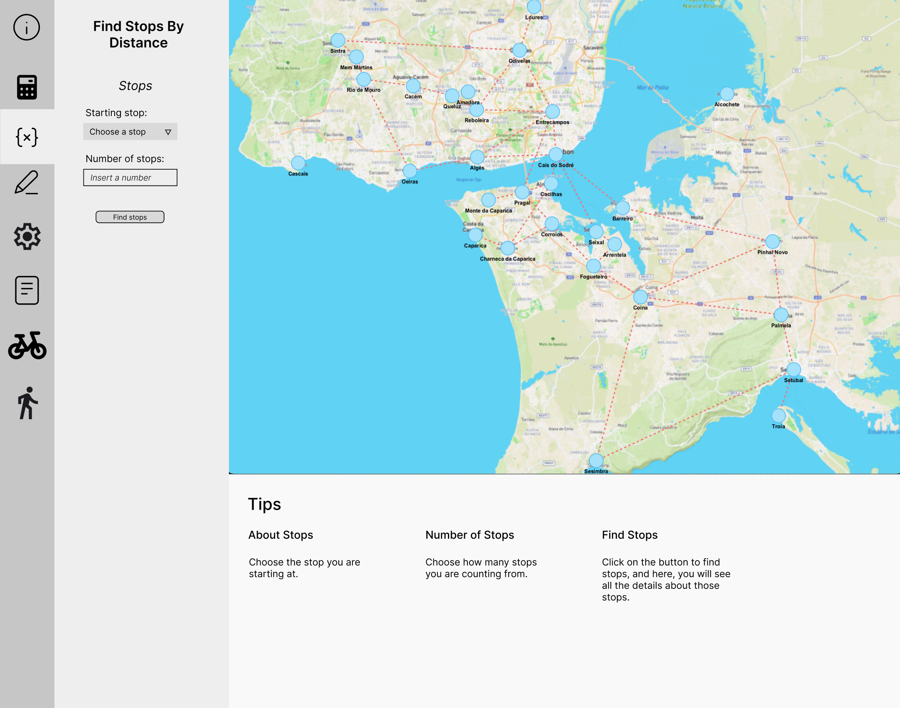
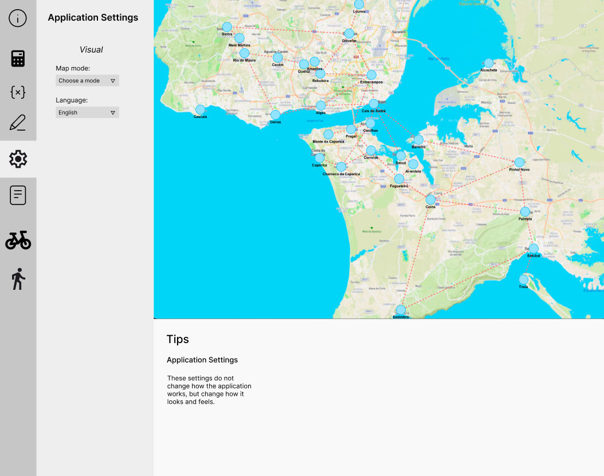
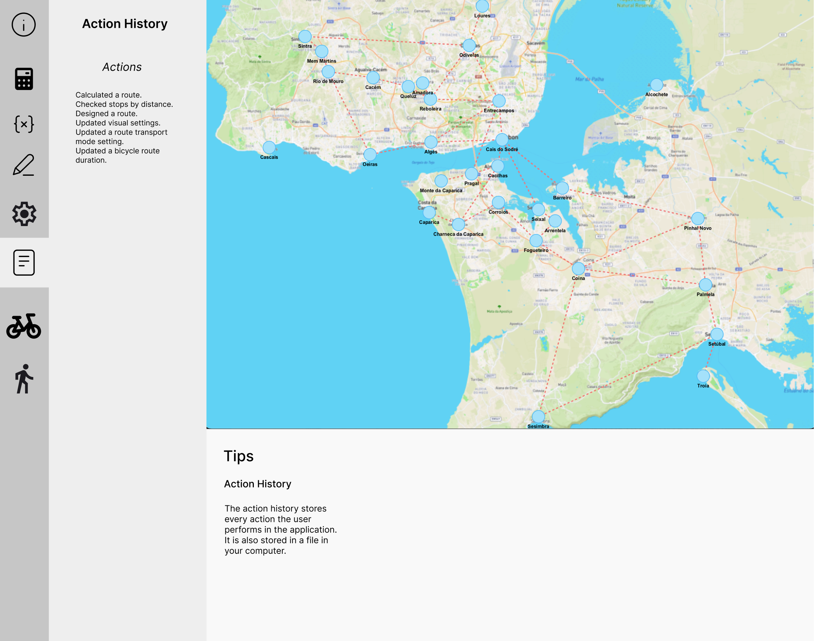
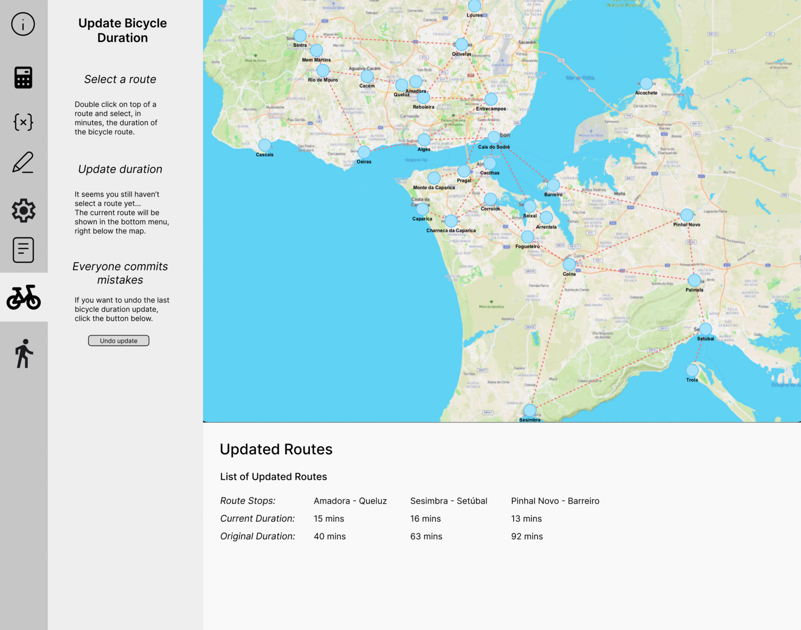

# Advanced Programming Project 2024/25 - Normal Season

: [Versão Portuguesa](README.md)

## SIT – Integrated Transport System

## Table of Contents:

* [Project Description](#project-description)
* [Data Structures](#data-structures)
  * [PropertiesUtil](#propertiesutil)
  * [StringManipulation](#stringmanipulation)
  * [MapView](#mapview)
  * [DataSetImporter](#datasetimporter)
  * [Stop](#stop)
  * [Route](#route)
  * [Transport](#transport)
  * [TransportMap](#transportmap)
* [Code Structure](#code-structure)
  * [`model` folder](#model-folder)
  * [`utils` folder](#utils-folder)
  * [`view` folder](#view-folder)
  * [Class Main](#class-main)
* [Unit Tests](#unit-tests)
  * [Tests for `DataSetImporter`](#tests-for-datasetimporter)
  * [Tests for `Stop`](#tests-for-stop)
  * [Tests for `Route`](#tests-for-route)
  * [Tests for `TransportMap`](#tests-for-transportmap)
  * [Tests for `Transport`](#tests-for-transport)
* [Graphical Interface Mockup](#graphical-interface-mockup)
  * [Base Graphical Interface Mockup](#base-graphical-interface-mockup)
  * [Information About Stops and Routes](#information-about-stops-and-routes)
  * [Information About the Information System](#information-about-the-information-system)
  * [Information About the Route Planner](#information-about-the-route-planner)
  * [Information About Stop Search by Distance](#information-about-stop-search-by-distance)
  * [Information About Route Creation](#information-about-route-creation)
  * [Information About Application Settings](#information-about-application-settings)
  * [Information About Action History](#information-about-action-history)
  * [Information About Updating Transportation Data](#information-about-updating-transportation-data)
  * [Information About Route State Management](#information-about-route-state-management)
* [Libraries/Dependencies](#librariesdependencies)
* [Java Development Kit](#java-development-kit)

---

### Project Description
The Integrated Transport System is an application that models an interconnected public transport network, offering various transport modes to facilitate travel between points in the network. This system allows users to plan journeys between stops, even when they require the use of multiple modes of transport, such as trains, buses, ferries, bicycles, or walking. With the graphical interface, the system provides an interactive visualization of the transport network.

 
**Graphical Interface on Application Start**

---

## Data Structures

### PropertiesUtil
A utility class for configuration management via a **properties file (config.properties)**. Implements the **Singleton** pattern to ensure a single instance is used throughout the application.

#### Main Features:
* Automatically loads the configuration file during initialization.
* Allows access to configuration values using keys.
* Checks if a specific key exists in the properties file.

#### Main Methods:
* `getProperty(String key)`: Returns the value of a specific key.
* `getProperty(String key, String defaultValue)`: Returns the value of a key or a default value if the key does not exist.
* `containsKey(String key)`: Checks if a key is present.

---

### StringManipulation
Provides utility methods for string manipulation and formatting.

#### Main Methods:
* `capitalizeFirstLetter(String string)`: Formats a string so that the first letter is uppercase and the remaining letters are lowercase.

---

### MapView
The MapView class provides an interactive graphical representation of the transport map using a graph to model the network of stops and routes. This class extends **BorderPane** to create a graphical interface based on the **SmartGraph** library.

#### Main Methods:
* `setupGraphPanel(Graph<Stop, Route>)`: Configures the graph panel by applying predefined properties and styles.
* `assignPositionsToStops()`: Positions the vertices in the graph based on imported coordinates.
* `setVertexClickAction()` and `setEdgeClickAction()`: Defines interactive actions (e.g., displaying details of stops and routes).
* `doLayout()`: Organizes the layout of the graphical interface.

---

### DataSetImporter
A utility class responsible for importing and processing datasets related to the transport system, including:

* **`Stop Import (Stops)`**: Reading and processing the **stops.csv** file containing stop information.
* **`XY Coordinates Import`**: Processing the **xy.csv** file to map stop codes to their positions on the map.
* **`Route Import (Routes)`**: Reading data from the **routes.csv** file to create route objects linking stops with different modes of transport.

#### Main Methods:
* `importStops()`: Returns a list of Stop objects from the CSV file.
* `importXY()`: Creates a map of coordinates associating stop codes with XY points.
* `importRoutes(Map<String, Stop> stopMap)`: Generates routes between stops, associating transport modes, distances, and corresponding costs.
* Auxiliary methods such as `adjustRouteData` (for handling incomplete data) and `parseNullableDouble` (for parsing optional numeric values).

---

### Stop
Represents a stop in the transport system, with a unique code, name, latitude, and longitude. This class provides geographical information for each stop and acts as a node in the transport map.

#### Attributes:
* `String code`: unique code of the stop.
* `String name`: name of the stop.
* `double latitude`: latitude coordinate.
* `double longitude`: longitude coordinate.
* `Point position`: visual position of the stop in the graph.

#### Main Methods:
* `getCode()`, `getName()`, `getLatitude()`, `getLongitude()`, `getPosition()`: methods to access stop attributes.
* `toString()`: returns the name of the stop as a textual representation.

---

### Route
Defines a route with various **transport options**. Each route includes a list of `Transport` instances, representing the available modes of transport, such as trains, buses, ferries, bicycles, or walking.

#### Attributes:
* `List transports`: list of available transport options for the route.

#### Main Methods:
* `getTransports()`: returns the list of available transport options for this route.

---

### Transport
Represents a mode of transport, such as a bus, train, or bicycle, used on a route. Includes information about the transport’s name, distance, duration, and cost, providing an overview of each transport option’s characteristics.

#### Attributes:
* `String name`: name of the transport (e.g., "Bus").
* `double distance`: distance covered.
* `double duration`: travel duration.
* `double cost`: environmental cost.

#### Main Methods:
* `getName()`, `getDistance()`, `getDuration()`, `getCost()`: methods to access transport attributes.
* `toString()`: textual representation of the transport with its name and distance.

---

### TransportMap
Manages the transport network, with stops represented as vertices and routes as edges. This class uses a graph to organize the transport structure, storing stops and routes.

#### Attributes:
* `Graph<Stop, Route> graph`: graph representing the transport network.
* `Set<String> uniqueTransportModes`: set of unique transport modes in the network.

#### Main Methods:
* `addStops(List<Stop> stops)`: adds a list of stops to the transport network.
* `addRoutes(List<Triplet<Stop, Stop, Route>> routes)`: adds a list of routes between stops.
* `numStops()`, `numRoutes()`: return the number of stops and routes in the network.
* `getStops()`, `getRoutes()`, `getGraph()`: return the collection of stops, routes, or the graph itself.
* `getUniqueTransportModes()`: returns a copy of the unique transport modes available in the network.

---

## Code Structure

The project follows a distinct directory structure, separating responsibilities into modules. Below is an overview of each module and its main purpose:

### **`model` folder**
Contains the main classes representing the entities of the transport system.

* `Route`: Represents a route between two stops and contains transport data, such as distance, cost, and duration.
* `Stop`: Defines a transport stop, including its unique identifier, name, and coordinates (latitude and longitude).
* `Transport`: Represents a specific mode of transport (e.g., bus, train, bicycle) and its associated properties, such as name, cost, duration, and distance.
* `TransportMap`:
    * Manages the application graph, where stops are vertices and routes are edges.
    * Allows adding new stops and routes and provides methods to access the number of vertices and edges in the graph.

### **`utils` folder**
Includes utility classes for data processing and configuration management.

* `DataSetImporter`: Responsible for importing and analyzing data files (e.g., stops, routes, coordinates) and converting them into usable objects in the transport system.
* `PropertiesUtil`: Manages the loading and access to configuration values from the `config.properties` file, implementing the Singleton pattern.
* `StringManipulation`: Provides utility methods for processing and formatting strings.

### **`view` folder**
Handles the graphical representation and user interaction with the transport system.

* **`MapView`**:
    * Responsible for the graphical visualization of the transport map.
    * Uses the `SmartGraph` library to render the graph on the graphical interface and defines specific positions for each stop based on imported coordinates.
    * Applies a layout to organize the graph and loads visual properties defined in a CSS file.

### **Class `Main`:**
- The main class that launches the application.
- Configures the graphical interface, imports stop and route data from CSV files, and organizes them into a graph.
- Builds an interactive visual representation of the transport network.

---

## Unit Tests

In the project, we utilize a wide range of unit tests to verify the core functionalities of the system's transportation classes. Below, we detail the implementation and test scenarios developed:

### Tests for `DataSetImporter`

- **Stop Import Test:**
    - Verifies whether the `importStops` method correctly loads stops from the CSV file.
    - Tests the number of stops and the presence of essential data (code, name, coordinates).

- **Route Import Test:**
    - Validates that the `importRoutes` method correctly loads routes.
    - Checks the mapping of stops and transport data (distance, duration, and cost).

- **Coordinate Import Test:**
    - Validates that the `testImportXY` method correctly loads stop coordinates.
    - Checks the mapping of stops and coordinate data (X position, Y position).

---

### Tests for `Stop`

- **Stop Creation:**
    - Ensures that stops are created correctly with valid attributes and that invalid inputs (out-of-range coordinates or null positions) throw the appropriate exceptions.

- **Access Methods:**
    - Verifies that methods like `getName()`, `getCode()`, `getLatitude()`, `getLongitude()`, and `getPosition()` return the expected values.

- **Stop Comparison:**
    - Tests that stops with the same attributes are not considered equal, respecting their uniqueness.

---

### Tests for `Route`

- **Transport Management:**
    - Ensures that the list of transports in the route is stored and returned correctly.

- **Route Validation:**
    - Tests that routes are created correctly and behave as expected and that invalid inputs (routes with no transportation modes) throw an exception.

---

### Tests for `TransportMap`

- **Adding Elements:**
    - Ensures that the number of stops and routes increases correctly when new elements are added.

- **Element Uniqueness:**
    - Tests that duplicate stops or routes result in the expected exceptions.

- **Data Queries:**
    - Verifies that methods like `getStops()` and `getRoutes()` return the correct stops and routes.

- **Unique Transport Modes:**
    - Ensures that `getUniqueTransportModes()` returns a list of unique transport modes in the map.

---

### Tests for `Transport`

- **Valid Attributes:**
    - Tests whether the name, distance, duration, and cost are set and accessed correctly.

- **Data Validation:**
    - Ensures that invalid inputs, such as negative distances or null names, result in errors.

- **Textual Representation:**
    - Verifies that the `toString()` method returns a description in the expected format.

---

## Graphical Interface Mockup

Below are the different screens of the application, including the base mockup, the screens of each tab, and the alternative modes available in each tab.

### Base Graphical Interface Mockup

Demonstrates the main structure of the interface that will be used across the various functionalities of the application. The interface consists of a map displaying the transport network and a side panel with various navigation tab options. At the bottom, complementary information is shown.

---

### Information About Stops and Routes

When selecting a stop or route, the corresponding data will be displayed in the bottom panel.

---

### Information About the Information System

In the information system tab, located in the side panel, statistics are presented, including the total number of stops, connected and isolated stops, as well as the total or possible number of routes. A table and a graph showing connections between stops are also available. At the bottom, tips on how to view route or stop details are provided.

---

### Information About the Route Planner

In the route planner tab, it is possible to select the origin and destination, the most important cost, and the possible means of transport. At the bottom, tips on how the functionality works or information related to the calculated route are displayed.

---

### Information About Stop Search by Distance

In the stop search by distance tab, it is possible to identify the stops closest to a specific location, based on a user-defined distance. At the bottom, tips on how this search works can be found, and later, the results of that same search.

---

### Information About Route Creation

In the route creation tab, users can choose a cost to prioritize and double-click on a stop to start the route. Once the user begins their route, they can go back on their decision and consult the bottom menu for more detailed information than what can be directly presented on the map.

---

### Information About Application Settings

In the application settings tab, users can change the map mode and the application language. At the bottom, information on how these options work is displayed.

---

### Information About Action History

In the action history tab, users can view various pieces of information related to the usage of the application in the current session.

---

### Information About Updating Transportation Data

In the bike duration adjustment tab, it is possible to select a route and input the new duration for that route. In the bottom menu, when no route is selected, a list of all routes whose bike duration has been adjusted is displayed. When a route is selected, the bottom menu presents a simplified version of the route details, showing only the current bike duration, the status of all transports on that route, and adjacent stops.

---

### Information About Route State Management

In the route state management tab, users can activate or deactivate transport modes between two stops selected by the user. When no route has been selected, the bottom menu shows all routes whose transport mode states have been modified. When a route is selected, all information about the route is simply displayed.

---

## Libraries/Dependencies

The project includes the following libraries imported via _Maven_:

- **JUnit 5.8.1** - for unit testing.
- **SmartGraph 2.0.0** - for graph visualization in the graphical interface.
- **OpenCSV 5.9** - for importing stop and route data from CSV files.
- **Javatuples 1.2** - for handling immutable data structures like pairs, triples, and other tuples.

## Java Development Kit

The project requires a version of the Java Development Kit (JDK) that supports JavaFX. We recommend using **BellSoft Liberica JDK, version 17 LTS (FULL)**.

Download available at [BellSoft Liberica JDK](https://bell-sw.com/pages/downloads/#/java-17-lts).

---
