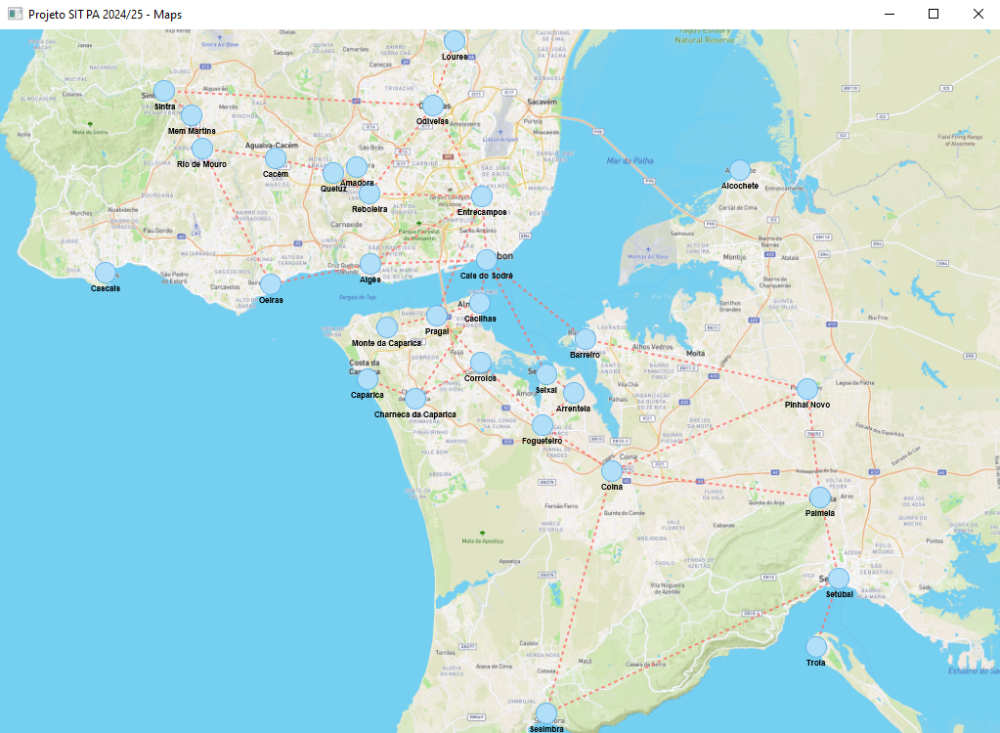
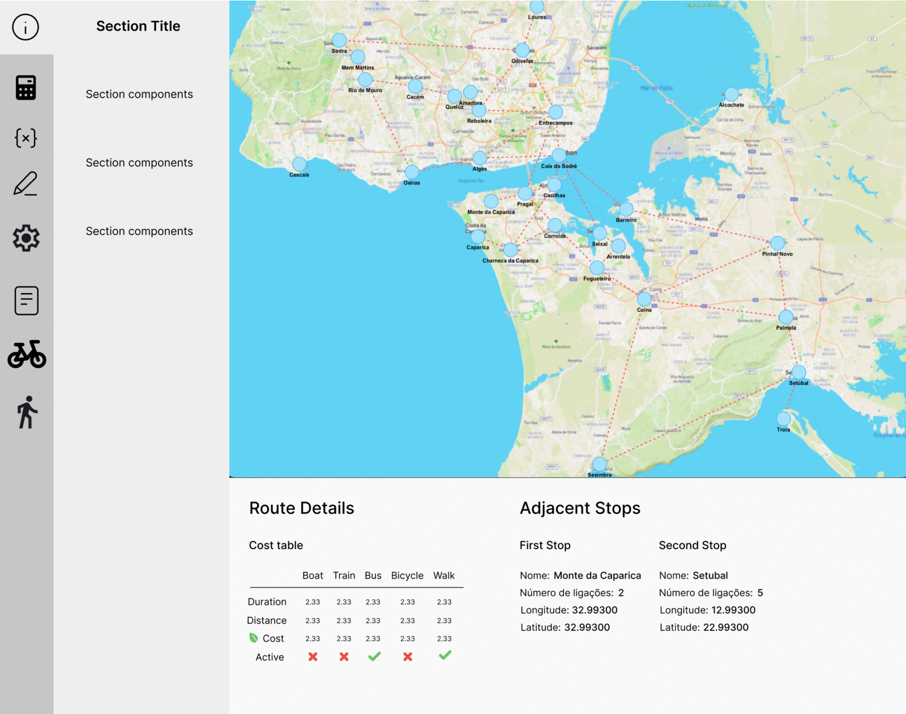
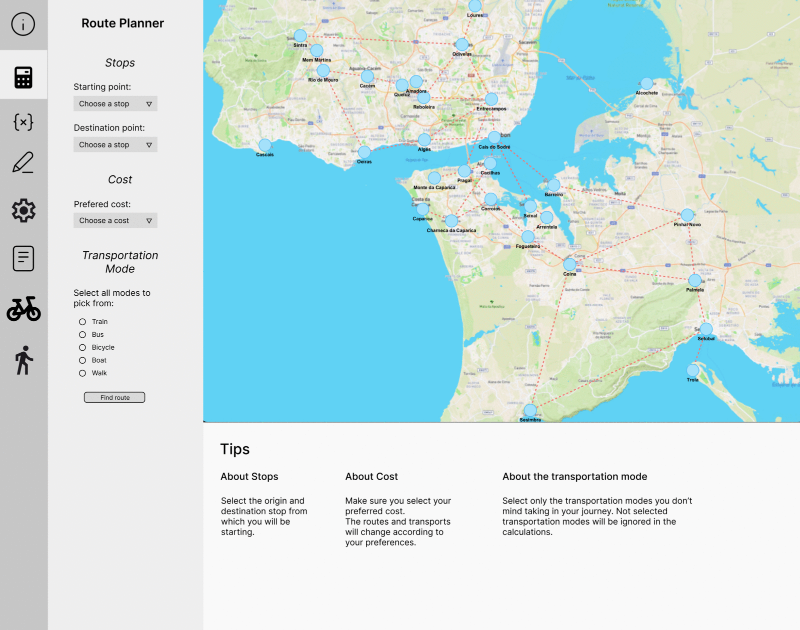
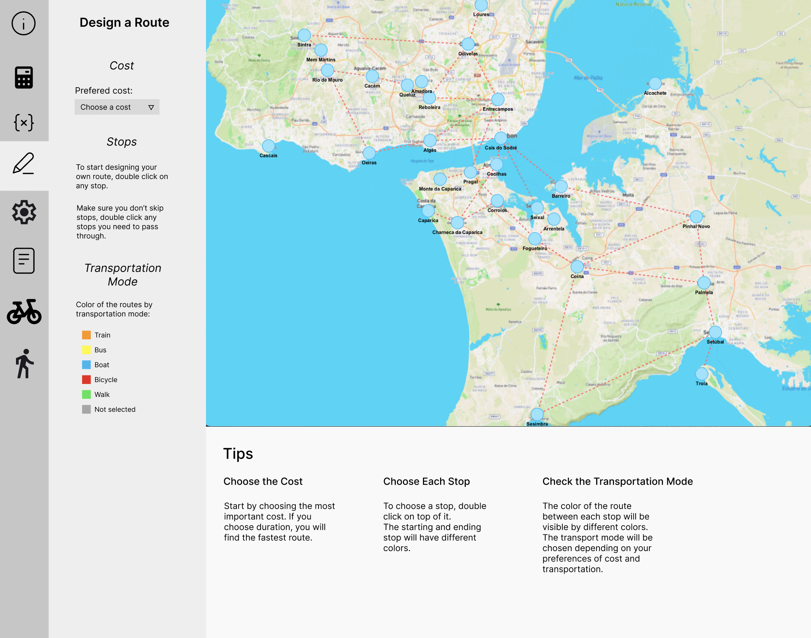
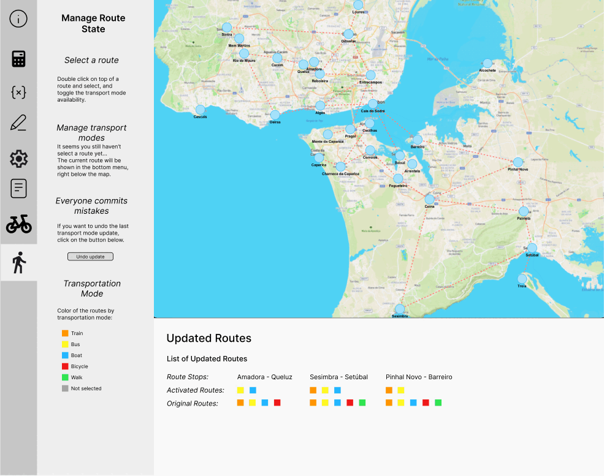

# Projeto Programação Avançada 2024/25 - Época Normal

: [English version](README_EN.md)

## SIT – Sistema Integrado de Transportes

## Índice:
* [Descrição do Projeto](#descrição-do-projeto)
* [Estrutura de Dados](#estrutura-de-dados)
  * [PropertiesUtil](#propertiesutil)
  * [StringManipulation](#stringmanipulation)
  * [MapView](#mapview)
  * [DataSetImporter](#datasetimporter)
  * [Stop](#stop)
  * [Route](#route)
  * [Transport](#transport)
  * [TransportMap](#transportmap)
* [Estrutura do Código](#estrutura-do-código)
  * [Pasta `model`](#pasta-model)
  * [Pasta `utils`](#pasta-utils)
  * [Pasta `view`](#pasta-view)
  * [Classe Main](#classe-main)
* [Testes Unitários](#testes-unitários)
  * [Testes para `DataSetImporter`](#testes-para-datasetimporter)
  * [Testes para `Stop`](#testes-para-stop)
  * [Testes para `Route`](#testes-para-route)
  * [Testes para `TransportMap`](#testes-para-transportmap)
  * [Testes para `Transport`](#testes-para-transport)
* [Mockup da Interface Gráfica](#mockup-da-interface-gráfica)
  * [Mockup Base da Interface Gráfica](#mockup-base-da-interface-gráfica)
  * [Informação Sobre Paragens e Rotas](#informação-sobre-paragens-e-rotas)
  * [Informação Sobre o Sistema de Informação](#informação-sobre-o-sistema-de-informação)
  * [Informação Sobre o Planeador de Percurso](#informação-sobre-o-planeador-de-percurso)
  * [Informação Sobre a Pesquisa de Paragens por Distância](#informação-sobre-a-pesquisa-de-paragens-por-distância)
  * [Informação Sobre a Criação de Rota](#informação-sobre-a-criação-de-rota)
  * [Informação Sobre as Definições da Aplicação](#informação-sobre-as-definições-da-aplicação)
  * [Informação Sobre o Histórico de Ações](#informação-sobre-o-histórico-de-ações)
  * [Informação Sobre a Alteração da Duração de Bicicleta](#informação-sobre-a-alteração-da-duração-de-bicicleta)
  * [Informação Sobre a Gestão de Estado da Rota](#informação-sobre-a-gestão-de-estado-da-rota)
* [Bibliotecas/dependências](#bibliotecasdependências)
* [Java Development Kit](#java-development-kit)

---

### Descrição do Projeto
O Sistema Integrado de Transportes é uma aplicação que modela uma rede de transporte público interligada, oferecendo diferentes meios de transporte para facilitar a deslocação de pessoas entre pontos da rede. Este sistema permite planear viagens entre paragens, mesmo quando estas requerem a utilização de vários modos de transporte, como comboio, autocarro, barco, bicicleta ou até deslocações a pé. Com a interface gráfica, o sistema permite uma visualização interativa da rede de transportes.

 
**Interface Gráfica ao Iniciar a Aplicação**

---

## Estrutura de Dados

### PropertiesUtil
Classe utilitária para a gestão de configurações via um ficheiro de propriedades **(config.properties)**. Implementa o padrão **Singleton** para garantir que uma única instância seja usada em toda a aplicação.

#### Principais Funcionalidades:
* Carrega automaticamente o ficheiro de configuração ao inicializar.
* Permite aceder a valores de configurações utilizando chaves.
* Verifica se uma chave específica existe no ficheiro de propriedades.

#### Principais Métodos:
* `getProperty(String key)`: Retorna o valor de uma chave especifica.
* `getProperty(String key, String defaultValue)`: Retorna o valor de uma chave ou um valor padrão se a chave não existir.
* `containsKey(String key)`: Verifica se uma chave está presente.

---

### StringManipulation
Fornece métodos utilitários para manipulação e formatação de strings.

#### Principais Métodos:
* `capitalizeFirstLetter(String string)`: Formata uma string para que a primeira letra seja maiúscula e as restantes sejam minúsculas.

---

### MapView
A classe MapView fornece uma representação gráfica interativa do mapa de transporte utilizando um grafo para modelar a rede de paragens e rotas. Esta classe estende **BorderPane** para criar uma interface gráfica, baseada na biblioteca **SmartGraph**.

#### Principais Métodos:
* `setupGraphPanel(Graph<Stop, Route>)`: Configura o painel do grafo, aplicando as propriedades e estilos definidos.
* `assignPositionsToStops()`: Posiciona os vértices no grafo com base nas coordenadas importadas.
* `setVertexClickAction()` e `setEdgeClickAction()`: Define ações interativas (ex.: apresentar detalhes das paragens e rotas).
* `doLayout()`: Organiza o layout do painel na interface gráfica.

---

### DataSetImporter
Uma classe utilitária responsável pela importação e processamento de conjuntos de dados relacionados ao sistema de transportes, incluindo:

* `Importação de Paragens (Stops)`: Leitura e processamento do ficheiro **stops.csv**, contendo informações sobre as paragens.
* `Importação de Coordenadas XY`: Processamento do ficheiro **xy.csv** para mapear códigos das paragens às suas posições no mapa.
* `Importação de Rotas (Routes)`: Leitura de dados do ficheiro **routes.csv** para criar objetos de rotas que interligam as paragens com diferentes modos de transporte.

#### Principais Métodos:
* `importStops()`: Retorna uma lista de objetos Stop a partir do ficheiro CSV.
* `importXY()`: Cria um mapa de coordenadas associando códigos de paragens a pontos XY.
* `importRoutes(Map<String, Stop> stopMap)`: Gera rotas entre paragens, associando modos de transporte, distancias e os custos correspondentes.
* Métodos auxiliares, como `adjustRouteData` (para lidar com dados incompletos) e `parseNullableDouble` (para conversão de valores numéricos opcionais).

---

### Stop
Representa uma paragem no sistema de transporte, com um código único, nome, latitude e longitude. Esta classe fornece informações geográficas de cada paragem e atua como um nó no mapa de transporte.

#### Atributos:
* `String code`: código único da paragem.
* `String name`: nome da paragem.
* `double latitude`: coordenada de latitude.
* `double longitude`: coordenada de longitude.
* `Point position`: posição visual da paragem no grafo.

#### Principais Métodos:

* `getCode()`, `getName()`, `getLatitude()`, `getLongitude()`, `getPosition()`: métodos para aceder aos atributos da paragem.
* `toString()`: devolve o nome da paragem como representação textual.

---

### Route
Define uma rota com várias opções de **transporte**. Cada rota inclui uma lista de instâncias `Transport`, que representam os modos de transporte disponíveis, como  comboio, autocarro, barco, bicicleta ou deslocações a pé.

#### Atributos:
* `List transports`: lista de opções de transporte disponíveis na rota.

#### Principais Métodos:
* `getTransports()`: devolve a lista de opções de transporte disponíveis nesta rota.

---

### Transport
Representa um meio de transporte, como um autocarro, comboio ou bicicleta, usado numa rota. Inclui informações sobre o nome do transporte, distância, duração e custo, proporcionando uma visão geral das características de cada opção de transporte.

#### Atributos:
* `String name`: nome do transporte (exemplo: "Autocarro").
* `double distance`: distância percorrida.
* `double duration`: duração da viagem.
* `double cost`: custo ambiental.

#### Principais Métodos:
* `getName()`, `getDistance()`, `getDuration()`, `getCost()`: métodos para aceder aos atributos do transporte.
* `toString()`: representação textual do transporte com nome e distância.

---

### TransportMap
Gere a rede de transporte, com paragens representadas como vértices e rotas como arestas. Esta classe utiliza um grafo para organizar a estrutura de transporte, armazenando paragens e rotas.

#### Atributos:
* `Graph<Stop, Route> graph`: grafo que representa a rede de transporte.
* `Set<String> uniqueTransportModes`: conjunto de meios de transporte únicos na rede.

#### Principais Métodos:
* `addStops(List<Stop> stops)`: adiciona uma lista de paragens à rede de transportes.
* `addRoutes(List<Triplet<Stop, Stop, Route>> routes`: adiciona uma lista de rotas entre paragens.
* `numStops()`, `numRoutes()`: devolvem o número de paragens e rotas na rede.
* `getStops()`, `getRoutes()`, `getGraph()`: devolvem a coleção de paragens, rotas ou o próprio grafo.
* `getUniqueTransportModes()`: devolve uma cópia dos meios de transporte únicos disponíveis na rede.

---

## Estrutura do Código

O projeto segue uma estrutura de diretorias distintas, separando as responsabilidades em módulos. Abaixo está uma visão geral de cada módulo e da sua finalidade principal:

### **Pasta `model`**
Contém as classes principais que representam as entidades do sistema de transportes.

* `Route`: Representa uma rota entre duas paragens e contém dados sobre o transporte, como distância, custo e duração.
* `Stop`: Define uma paragem de transporte, incluindo o seu identificador único, nome e coordenadas (latitude e longitude).
* `Transport`: Representa um modo de transporte específico (ex.: autocarro, comboio, bicicleta) e as suas propriedades associadas, como nome, custo, duração e distância.
* `TransportMap`: 
  * Gere o grafo da aplicação, onde as paragens representam os vértices e as rotas são as arestas. 
  * Permite a adição de novas paragens e rotas e fornece métodos para aceder ao número de vértices e arestas do grafo.

### **Pasta `utils`**
Inclui classes utilitárias para o processamento de dados e gestão de configurações.

* `DataSetImporter`: Responsável pela importação e análise de ficheiros de dados (ex.: paragens, rotas, coordenadas) e pela sua conversão em objetos utilizáveis no sistema de transportes.
* `PropertiesUtil`: Gere o carregamento e acesso aos valores de configuração do ficheiro `config.properties`, implementando o padrão Singleton.
* `StringManipulation`: Fornece métodos utilitários para processar e formatar strings.

### **Pasta `view`**
Lida com a representação gráfica e a interação do utilizador com o sistema de transportes.

* **`MapView`**:
  * Responsável pela visualização gráfica do mapa de transportes. 
  * Utiliza a biblioteca `SmartGraph` para renderizar o grafo na interface gráfica e define posições específicas para cada paragem com base nas coordenadas importadas. 
  * Aplica um layout para organizar o grafo e carrega as propriedades visuais definidas num ficheiro CSS.

### **Classe `Main`:**
  * A classe principal que inicia a aplicação. 
  * Configura a interface gráfica, importa os dados das paragens e das rotas de ficheiros CSV e organiza-os num grafo. 
  * Constrói uma representação visual interativa da rede de transportes.

---

## Testes Unitários

No projeto utilizamos ampla gama de testes unitários para verificar as funcionalidades principais das classes do sistema de transporte. A seguir, detalhamos a implementação e os cenários de testes desenvolvidos:

### Testes para `DataSetImporter`

* **Teste de Importação de Paragens:**
    * Verifica se o método `importStops` carrega corretamente as paragens a partir do ficheiro CSV.
    * Testa o número de paragens e a presença de dados essenciais (código, nome, coordenadas).

* **Teste de Importação de Rotas:**
    * Valida que o método `importRoutes` carrega corretamente as rotas.
    * Verifica a correspondência das paragens e os dados de transporte (distância, duração e custo).

* **Teste de Importação de Coordenadas:**
    * Valida que o método `testImportXY` carrega corretamente as coordenadas das paragens.
    * Verifica a correspondência das paragens e os dados de coordenadas (posição X, posição Y).

---

### Testes para `Stop`
* **Criação de paragens:**
    * Garante que as paragens são criadas corretamente com atributos válidos e que entradas inválidas (coordenadas fora do intervalo ou posições nulas) lançam as excepções apropriadas. 
* **Métodos de acesso:**
    * Verifica que métodos como `getName(), getCode(), getLatitude(), getLongitude() e getPosition()` devolvem os valores esperados. 
* **Comparação de paragens**: 
    * Testa se paragens com os mesmos atributos não são consideradas iguais, respeitando a sua unicidade.

---

### Testes para `Route`
* **Gestão de transportes:** 
  * Garante que a lista de transportes na rota é armazenada e devolvida correctamente. 
* **Validação de rotas:**
  * Testa se as rotas são criadas correctamente e se comportam conforme o esperado e que entradas inválidas (rotas sem transportes) lançam uma exceção.

---

### Testes para `TransportMap`
* **Adição de elementos:**
  * Garante que o número de paragens e rotas aumenta corretamente quando novos elementos são adicionados. 
* **Unicidade de elementos:**
  * Testa a unicidade de paragens ou rotas, resultam nas excepções esperadas. 
* **Consulta de dados:**
  * Verifica que métodos como `getStops()` e `getRoutes()` devolvem as paragens e rotas correctas. 
* **Modos de transporte únicos:**
  * Assegura que `getUniqueTransportModes()` devolve uma lista com os modos de transporte únicos no mapa.

---

### Testes para `Transport`
* **Atributos válidos:**
  * Testa se o nome, a distância, a duração e o custo são definidos e acedidos correctamente. 
* **Validação de dados:**
  * Assegura que entradas inválidas, como distâncias negativas ou nomes nulos, resultam em erros. 
* **Representação textual:**
  * Verifica que o método `toString()` devolve uma descrição no formato esperado.

---

## Mockup da Interface Gráfica

Abaixo encontram-se os diferentes ecrãs da aplicação, incluindo o mockup base, os ecrãs de cada aba e, por fim, os modos alternativos disponíveis em cada aba.

### Mockup Base da Interface Gráfica

Demonstra a estrutura principal da interface que será utilizada ao longo das várias funcionalidades da aplicação. A interface é composta por um mapa que apresenta a rede de transportes e por um painel lateral com várias opções de navegação entre abas. Na parte inferior, são mostradas informações complementares.

---

### Informação Sobre Paragens e Rotas

Ao selecionar uma paragem ou rota, será possível visualizar os dados correspondentes no painel inferior.

---

### Informação Sobre o Sistema de Informação

Na aba de sistema de informação, localizada no painel lateral, são apresentadas estatísticas, incluindo o número total de paragens, paragens conectadas e isoladas, bem como o número total ou possível de rotas. Também estão disponíveis uma tabela e um gráfico que mostram as conexões entre paragens. Na parte inferior, encontram-se dicas sobre como consultar os detalhes de rotas ou paragens.

---

### Informação Sobre o Planeador de Percurso

Na aba do planeador de percurso, é possível selecionar a origem e o destino, o custo mais importante e os meios de transporte possíveis. Na parte inferior, são mostradas dicas sobre como a funcionalidade funciona, ou informações relacionadas com o percurso calculado.

---

### Informação Sobre a Pesquisa de Paragens por Distância

Na aba de pesquisa de paragens por distância, é possível identificar as paragens mais próximas de uma localização específica, com base numa distância definida pelo utilizador. Na parte inferior, pode encontrar dicas sobre como funciona esta pesquisa, e mais tarde, os resultados dessa mesma pesquisa.

---

### Informação Sobre a Criação de Rota

Na aba de criação de rota, é possível escolher um custo a priorizar, e clicar duas vezes sobre uma paragem para começar o percurso. Assim que o utilizador começar o seu percurso, ele poderá voltar a trás na sua decisão, bem como consultar o menu inferior com informação mais detalhada do que pode ser apresentado diretamente no mapa.

---

### Informação Sobre as Definições da Aplicação

Na aba de definições da aplicação, é possível alterar o modo do mapa e a linguagem da aplicação. Na parte inferior, são mostradas informações sobre como estas funcionam.

---

### Informação Sobre o Histórico de Ações

Na aba de histórico de ações, é possível consultar diversas informações relacionadas com a utilização da aplicação na sessão atual.

---

### Informação Sobre a Alteração da Duração de Bicicleta

Na aba da alteração da duração de bicicleta é possível selecionar uma rota, e introduzir a nova duração para essa rota. No menu inferior, quando não existe nenhuma rota selecionada, é apresentada uma lista de todas as rotas cuja duração de bicicleta foi alterada. Quando uma rota já foi selecionada, o menu inferior apresenta uma versão simplificada dos detalhes de rotas com apenas a duração atual da bicicleta, o estado de todos os transportes daquela rota, e as paragens adjacentes. 

---

### Informação Sobre a Gestão de Estado da Rota

Na aba de gestão de estado da rota, é possível ativar ou desativar meios de transporte entre duas paragens selecionadas pelo utilizador. Quando não foi selecionada rota nenhuma, o menu inferior apresenta todas as rotas cujo estado dos modos de transporte foram alterados. Quando uma rota é selecionada, simplesmente é apresentada toda a informação sobre a rota.

---

## Bibliotecas/dependências

O projeto tem as seguintes bibliotecas importadas a partir do _Maven_:

* JUnit 5.8.1 - para testes unitários. 
* SmartGraph 2.0.0 - para a visualização do grafo na interface gráfica. 
* OpenCSV 5.9 - para a importação de dados de paragens e rotas a partir de ficheiros CSV. 
* Javatuples 1.2 - para manipulação de estruturas de dados imutáveis como pares, triplos e outras tuplas.

## Java Development Kit
O projeto requer uma versão do Java Development Kit (JDK) com suporte para JavaFX. Recomenda-se a utilização da **BellSoft Liberica JDK, versão 17 LTS (FULL)**.

Transferência disponível em [BellSoft Liberica JDK](https://bell-sw.com/pages/downloads/#/java-17-lts)

---
